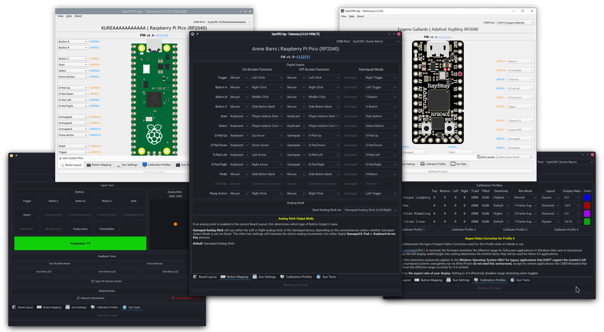
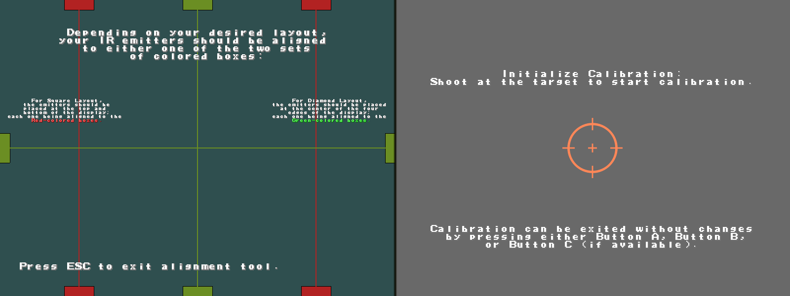

#### Like our work? [Remember to support the developers!](https://github.com/TeamOpenFIRE/.github/blob/main/profile/README.md)

[English](#english-version) · [Italiano](#versione-italiana)

<a id="english-version"></a>


# OpenFIRE ESP32 Desktop Configuration App
### Desktop configuration utility for the [OpenFIRE ESP32 firmware](https://github.com/alessandro-satanassi/OpenFIRE-Firmware-ESP32) 7.x, derived from the original [OpenFIRE App](https://github.com/TeamOpenFIRE/OpenFIRE-App).

> **Prefer a desktop program?** This App offers the main configuration and testing functions for those who prefer a program to install or cannot use the WebApp in their browser. The official configuration tool for OpenFIRE ESP32 7.x is the [WebApp](https://alessandro-satanassi.github.io/OpenFIRE-ESP32-WebApp/?lang=en), which runs in the browser with nothing to install and is also stored in the gun for offline use.
>
> It works only with OpenFIRE ESP32 firmware 7.x. The original OpenFIRE App, and the Apps for earlier ESP32 firmware, use a different configuration protocol and do not work with 7.x.

## Download
Download the App from the **OpenFIRE App CUSTOM for ESP32 7.x firmware** section of the [Tools page](https://alessandro-satanassi.github.io/OpenFIRE-ESP32-Tools/?lang=en). Do not use the other builds on that page, which belong to the original project.

## Features:
 - **Cross-platform Qt application** for Windows, Linux and macOS desktops.
 - **Simple to use:** plug in the gun, select it from the drop-down list and configure it.
 - See and change the pin layout, enable custom mappings, and adjust force feedback, I2C peripherals, camera model and other settings on the fly.
 - Calibrate any profile in an interactive full-screen window that also shows whether the camera sees the IR emitters well, as in the WebApp.
 - See the ideal emitter placement with the IR Emitter Alignment Assistant.
 - Preview the layouts of all supported boards and the functions available on each pin, to make wiring your lightgun easier.
 - Test digital and analog inputs, force feedback devices, the IR camera and more.

## Running:
Start `OpenFIREapp`. Available devices are refreshed periodically and listed in the *COM Port* drop-down box. Even with no device plugged in, you can open the *IR Emitter Alignment Assistant* or preview the supported boards and their default layouts with *View Compatible Boards* in the *Help* menu.

When a gun is connected, select its port to dock it to the App (any previously docked gun is undocked). A gun running firmware that does not talk to the App correctly can be restarted into update mode, so it can be updated with the [Web Flasher](https://alessandro-satanassi.github.io/OpenFIRE-ESP32-WebFlasher/?lang=en).

While connected to the App, the gun is in configuration mode and normal play is suspended. Use **Save and Send Settings**, wait for confirmation, then disconnect and close the App before playing. If the gun was started in offline WebApp mode by holding B, restart it normally to restore its USB serial port before connecting this App. The [operational manual](https://github.com/alessandro-satanassi/OpenFIRE-Firmware-ESP32/blob/main/lightgun/src/README.md#english-version) explains calibration, profiles and the first game.



### For Linux:
##### Requirements: Qt 5.15.x or later.
 - Make sure your user belongs to the `dialout` group; the App tells you at startup if this permission is missing. An administrator can add the user with `usermod -a -G dialout yourusername`. Log out and back in for the change to take effect.
   - If the command answers `usermod: group 'dialout' does not exist`, an administrator must create the group first with `groupadd dialout`; then add the user and reboot before trying again.

### For Windows:
##### Requirements: Windows 10 or later (64-bit only).
 - Extract the `OpenFIREapp` folder from the downloaded archive anywhere convenient: `OpenFIREapp.exe` must stay next to `Qt6Core.dll` and the other files, and the `platforms` and `styles` folders.
 - Start `OpenFIREapp.exe`.

---

<a id="versione-italiana"></a>

# App desktop di configurazione OpenFIRE ESP32

App di configurazione per il [firmware OpenFIRE ESP32](https://github.com/alessandro-satanassi/OpenFIRE-Firmware-ESP32) 7.x, derivata dall'[App OpenFIRE originale](https://github.com/TeamOpenFIRE/OpenFIRE-App).

> **Preferisci un programma desktop?** Questa App offre le principali funzioni di configurazione e test per chi preferisce un programma da installare o non può usare la WebApp nel proprio browser. Lo strumento ufficiale di configurazione per OpenFIRE ESP32 7.x è la [WebApp](https://alessandro-satanassi.github.io/OpenFIRE-ESP32-WebApp/?lang=it), che funziona nel browser senza installare nulla ed è anche memorizzata nella pistola per l'uso offline.
>
> Funziona solo con il firmware OpenFIRE ESP32 7.x. L'App OpenFIRE originale e quelle per i precedenti firmware ESP32 usano un protocollo di configurazione diverso e non funzionano con la 7.x.

## Download

Scarica l'App dalla sezione **OpenFIRE App CUSTOM per firmware ESP32 7.x** della [pagina Tools](https://alessandro-satanassi.github.io/OpenFIRE-ESP32-Tools/?lang=it). Non usare le altre versioni presenti nella pagina, che appartengono al progetto originale.

## Funzioni

- **App desktop multipiattaforma** per Windows, Linux e macOS.
- **Uso semplice:** collega la pistola, selezionala dall'elenco e configurala.
- Visualizza e modifica i pin, personalizza i comandi e regola force feedback, periferiche I2C, modello di telecamera e altre impostazioni.
- Calibra ogni profilo in una finestra interattiva a schermo intero, che mostra anche se la telecamera vede bene gli emettitori IR, come nella WebApp.
- Visualizza la disposizione ideale degli emettitori con l'Assistente di allineamento degli emettitori IR.
- Consulta il layout di tutte le schede supportate e le funzioni disponibili sui pin, per facilitare il cablaggio.
- Prova ingressi digitali e analogici, dispositivi di force feedback, telecamera IR e altre funzioni della pistola.

## Avvio e uso

Avvia `OpenFIREapp`. L'elenco dei dispositivi viene aggiornato periodicamente nella casella *COM Port*. Anche senza una pistola collegata puoi aprire *IR Emitter Alignment Assistant* o consultare le schede supportate e i pin predefiniti con *View Compatible Boards* nel menu *Help*.

Collega la pistola e seleziona la sua porta per connetterla all'App (una pistola già connessa viene disconnessa). Se il firmware non comunica correttamente con l'App, puoi riavviare la pistola in modalità aggiornamento e aggiornarla con il [Web Flasher](https://alessandro-satanassi.github.io/OpenFIRE-ESP32-WebFlasher/?lang=it).

Mentre è collegata all'App, la pistola è in modalità configurazione e il gioco normale è sospeso. Usa **Save and Send Settings**, attendi la conferma, poi disconnetti e chiudi l'App prima di giocare. Se la pistola è stata avviata nella modalità WebApp offline tenendo premuto B, riavviala normalmente per ripristinare la porta seriale USB prima di collegare questa App. Il [manuale operativo](https://github.com/alessandro-satanassi/OpenFIRE-Firmware-ESP32/blob/main/lightgun/src/README.md#versione-italiana) spiega calibrazione, profili e prima partita.

### Linux

**Requisiti:** Qt 5.15.x o successivo.

- L'utente deve appartenere al gruppo `dialout`; l'App segnala all'avvio se manca questo permesso. Un amministratore può aggiungerlo con `usermod -a -G dialout nomeutente`. Dopo la modifica esci dalla sessione e rientra.
- Se compare `usermod: group 'dialout' does not exist`, un amministratore deve creare prima il gruppo con `groupadd dialout`; poi aggiungi l'utente e riavvia prima di riprovare.

### Windows

**Requisiti:** Windows 10 o successivo, a 64 bit.

- Estrai la cartella `OpenFIREapp` dall'archivio scaricato dove preferisci: `OpenFIREapp.exe` deve restare accanto a `Qt6Core.dll` e agli altri file, con le cartelle `platforms` e `styles`.
- Avvia `OpenFIREapp.exe`.

---

## Building:

**Developer reference / Riferimento per gli sviluppatori:** the following instructions are for building the App from source, not for installing the ready-made App. Le istruzioni seguenti, in inglese, servono a compilare l'App dai sorgenti e non sono necessarie per installare l'App pronta da scaricare. The App is written in Qt & C++.

### For Linux:
#### Arch: requires `qtX-base` `qtX-serialport` `qtX-svg` for your desired Qt version.
#### Debian: requires `build-essential` `cmake` `qttools5-dev` `libqt5serialport5-dev` `libqt5svg5-dev` (either Qt5 or Qt6 libraries)
 - From the folder of this repository, set up the build directory:
   ```
   mkdir build && cd build
   cmake .. -DCMAKE_BUILD_TYPE=Release
   ```
   * CMake uses the newest Qt version whose development headers are installed. To build with Qt5 on a system that also has Qt6, add `-DOFAPP_QT_VERSION=Qt5` to the options.
 - Make:
   ```
   make
   ```
 - And run:
   ```
   ./OpenFIREapp
   ```
### For Windows:
#### Qt 5.15.2 must be installed from the Archive section of the Qt Installation Wizard/Maintenance Tool, which includes all the needed components
#### Qt 6.x requires the SerialPort extension for that version
 - Open the project in Qt Creator, with the Qt libraries for your chosen version installed. Building with CMake inside a mingw-w64 environment should also work, but has not been tested thoroughly.

## Special Thanks:
 * That One Seong, author of the original OpenFIRE App this one is based on.
 * Samuel Ballantyne, Prow7, and co. for their work on the SAMCO system & derivatives, and supporting work and conception of OpenFIRE.
 * Odwalla-J, mrkylegp, RG2020 & lemmingDev for prerelease consultation, bug testing and feedback.
 * All early IR-GUN4ALL testers and ArcadeForums users who provided early testing and feedback.
